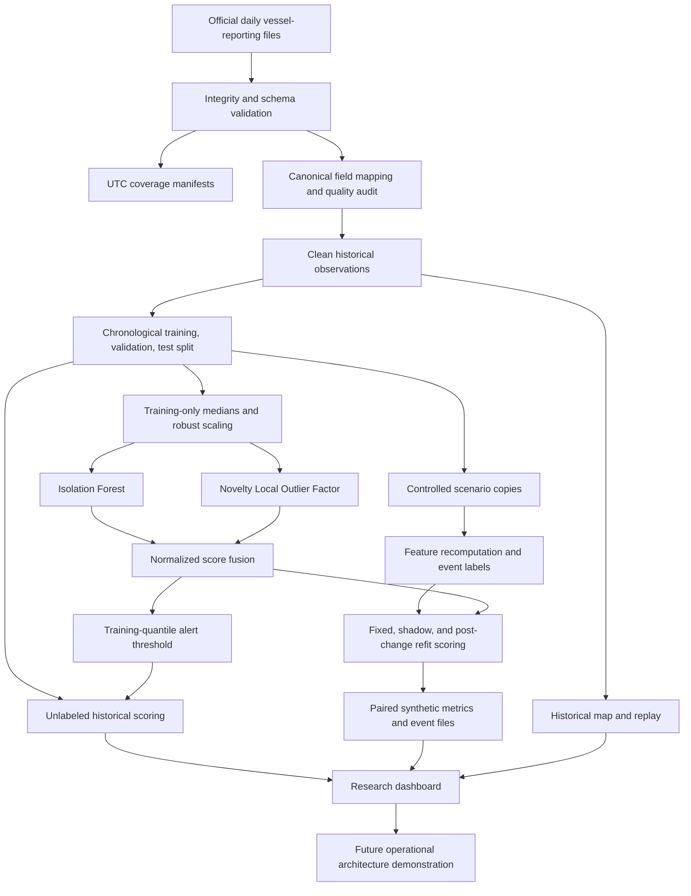

# An Adaptive Multimodel Framework for Maritime Anomaly Screening Under Distribution Change and Incomplete Observations

> **Formatting note:** This Markdown contains report content. In the institutional word-processing template, set abstract paragraphs in Times New Roman, 12 point, single spaced, first-line indent 15 mm, with no extra spacing between abstract paragraphs. Apply the template's chapter styles and pagination.

# ABSTRACT

Maritime transport is monitored through repeated vessel position and movement reports that support traffic analysis, safety review, and operational awareness. Large automatic identification system archives contain both ordinary variation and potentially unusual movement patterns, making comprehensive manual screening difficult.

The problem addressed is that unusual behavior is rare, contextual, and unlabelled in the historical records used here. Missing reports, uneven sampling, vessel differences, and changing traffic distributions can cause fixed screening rules to miss events or generate excessive alerts. The main aim is to implement and examine a reproducible unsupervised framework for screening maritime movement observations while making the limits of its evidence explicit.

The project verifies daily source files, preprocesses observations, engineers trajectory features, and trains a robust-scaled ensemble of isolation-based and neighborhood-density detectors. It compares fixed and shadow-refit models, evaluates controlled synthetic changes against paired unmodified observations, and presents historical and simulated results through an interactive research dashboard.

The dataset comprises verified United States Marine Cadastre daily observations for 1 January 2024 and 1–7 January 2024; each experiment uses a deterministic sample of 200,000 rows. Evaluation reports training and inference time, unlabeled historical alert rates, and controlled-synthetic precision, recall, harmonic mean of precision and recall, receiver operating characteristic area, precision-recall area, confusion counts, paired-control false-positive rate, and detection delay where defined. Independently verified real-world accuracy is unavailable.

**Keywords:** maritime monitoring; anomaly screening; vessel trajectories; unsupervised learning; controlled evaluation; distribution change

# CHAPTER 1: INTRODUCTION

## 1.1 Background

Maritime transport is central to international trade, supply chains, fisheries, energy logistics, and coastal activity. Ports, shipping lanes, anchorages, and navigational approaches are used by vessels with different roles, sizes, operating limits, and movement patterns. Understanding those patterns supports traffic management, research, and operational awareness. At regional and national scales, however, the volume of observations is far too large for analysts to inspect every report manually.

The automatic identification system is a cooperative maritime reporting technology. Depending on equipment, carriage requirements, reception, and operating conditions, a vessel transmits identity and movement information. Shore stations and satellites may receive the messages, after which providers aggregate them into historical data products. A typical position report contains a vessel identifier, timestamp, latitude and longitude, speed over ground, course over ground, heading, and possibly a vessel classification. When observations are ordered in time, they can be grouped into tracks and used to derive elapsed time, distance, speed change, course change, and turn rate.

These records are observations of a reporting and receiving system, not a perfect record of continuous physical movement. Reports may be delayed, duplicated, missing, or inconsistent. Reception varies by geography and technology. Vessel clocks, sensors, and static metadata may have errors. A long interval between two records does not justify assuming a straight-line route or constant speed. The same movement can be routine for one vessel or location and unusual for another. A vessel stationary in an anchorage may be expected, while a long stop in a constrained traffic lane may merit investigation. Maritime anomaly screening is consequently a contextual problem, not merely a search for large numeric values.

Anomaly-detection software can help analysts prioritize observations for review. In an unsupervised setting, a model learns structure from observations without a trusted label for every row. This is practical where reviewed examples are scarce or expensive. Its output is nevertheless a relative score under a selected representation and fitted population. A score does not establish that a vessel behaved dangerously, unlawfully, or intentionally. This work is a research screening prototype, not an autonomous maritime enforcement or safety decision system.

The implemented detector combines an isolation-based method with a local-density method. The former identifies observations that can be separated from the fitted sample with relatively short randomized partitions. The latter compares local density around a new observation with the density around neighboring training observations. Their scores are normalized with training statistics and combined. A threshold is calibrated from training scores and is not chosen using test labels.

The broader motivation is the tension between data volume and evidential certainty. A historical archive can contain millions of rows, but a large number of rows does not automatically yield a reliable estimate of rare event performance. If labels are unavailable, a model can still be trained to identify unusual patterns, yet no statistical procedure can infer which flagged observations correspond to meaningful incidents without additional evidence. This project treats the score as a way to prioritize review and investigates model behavior on controlled inputs; it does not convert the score into a claim about a vessel's intent.

Vessel reports are also different from the regularly sampled sensor streams often assumed in time-series modeling. The interval between observations may range from minutes to hours, and a missing report may reflect reception loss rather than a vessel's abrupt movement. Computing distance between successive records without considering the elapsed time can produce implausible speeds. Similarly, course angles wrap at 360 degrees: a change from 359 degrees to 1 degree is two degrees, not a 358-degree turn. Feature engineering must preserve these units and boundaries before a model can learn a meaningful representation.

Context has several levels. A movement may be atypical for an individual vessel but routine for its vessel class. A stationary vessel may be expected in a port or anchorage but less expected in a narrow transit corridor. A week with more reports from one area may reflect source reception, vessel mixture, or sampling, rather than a genuine change in behavior. The current project uses a limited common feature set and does not fully encode these contexts. This motivates treating results as exploratory and documenting the contextual information that future models should add.

The project is organized around two complementary kinds of evidence. The first is historical evidence: verified source coverage, observed distributions, data-quality summaries, model scores, and thresholded alerts on chronological held-out records. This evidence reflects real source observations, but without labels it is descriptive rather than a measure of classification correctness. The second is controlled evidence: transformations are applied to held-out observations and their model response is measured against original counterfactual copies. This evidence has known intervention labels, but it represents the chosen simulator rather than verified real-world events. Keeping the two evidence classes separate is necessary for interpreting the results correctly.

The same distinction applies to the dashboard. It is designed to help a researcher navigate experiments, inspect vessel tracks, compare scores, and activate scenarios. When the user changes a scenario, the simulator recomputes the model features and invokes a saved bundle; it does not directly set a prediction to anomalous. The visible event log identifies its source as simulated. A separate future operational panel outlines how ingestion and review could be connected later, while clearly stating that there is no live feed in this prototype. Therefore, the interface is a research demonstration and not an operational surveillance system.

The scope is intentionally constrained to the two successful experiment windows. The one-day run is a baseline with a single verified date. The seven-day run supplies a wider but still short window, with the same total sample cap so that duration, not a seven-fold increase in sample size, is the principal design difference. Both use seed 42, the same broad model architecture, and the same chronological split fractions. This supports a controlled comparison of outputs while leaving major questions about seasonal coverage, geography, class-specific behavior, and external validity unresolved.

In this setting, “reliability” refers primarily to computational and methodological reproducibility: source dates are checked, model inputs are explicit, thresholds are held fixed for test scoring, and experiments preserve their own artifacts. It does not mean that the detector has been proven reliable at identifying actual maritime incidents. A reliable process can produce evidence of poor model performance; that distinction is important in research and is reflected in the results and conclusion.

The research questions follow from this scope. First, can the official daily files be validated and transformed into reproducible samples with recorded coverage? Second, do the selected unsupervised models produce stable screening outputs on a later chronological partition? Third, does a controlled change reach the features that the saved model actually consumes, and how does the score respond? Fourth, what can be stated about those outputs when labels are unavailable? The study answers the first question affirmatively for the two retained windows, answers the second descriptively through score and alert statistics, and addresses the third with synthetic tests and scenario results. The fourth question imposes the main limitation: real-world classification accuracy remains unknown.

The intended user is a researcher or analyst who needs to inspect records, test a hypothesis, and decide which observations deserve further review. The system is not designed to issue legal conclusions, identify intent, or automatically direct a vessel response. Any later operational use would require authorization, independent validation, audit procedures, and appropriate human oversight. These are not optional deployment details; they follow from the difference between a mathematical outlier score and a verified maritime incident.

Two verified experimental windows are used: one day and seven consecutive days beginning on 1 January 2024. Both have a deterministic maximum sample of 200,000 observations and a fixed seed. The experiments demonstrate source validation, preprocessing, model fitting, held-out scoring, synthetic evaluation, and dashboard integration. They do not establish seasonal, global, or operational representativeness.

## 1.2 Problem Statement

Maritime analysts need to find unusual movement observations in large, incomplete vessel-reporting data, but the available historical records have no independently adjudicated anomaly labels. Therefore, real-world model accuracy cannot be measured directly, and the proportion of observations flagged cannot be interpreted as the proportion of mistakes.

The research problem is to build a reproducible, data-preserving anomaly-screening workflow that uses actual vessel observations, applies consistent chronological evaluation, tests model response to controlled changes, and reports uncertainty without presenting synthetic results as verified incidents. The workflow must guard against distorted movement features across reporting gaps, preserve source provenance, calibrate thresholds without test labels, and distinguish historical analysis from simulation.

## 1.3 Objectives of the Study

The main objective is to implement and evaluate a reproducible unsupervised framework for screening unusual maritime movement patterns in verified historical vessel-reporting data. The objectives are arranged from data reliability to model evaluation and presentation so that each downstream result can be traced to an upstream processing decision.

- Acquire and validate daily source files, including integrity checks and timestamp-based date coverage.
- Map source fields to a canonical schema and retain data-quality audit flags.
- Engineer trajectory features while excluding invalid or long-gap movement calculations.
- Fit a robust-scaled Isolation Forest and novelty Local Outlier Factor ensemble using chronological training, validation, and test partitions.
- Compare fixed and shadow-refit models on identical held-out rows, documenting training time, inference time, thresholds, and alert rates.
- Diagnose the speed-change simulation and build reproducible controlled cases for speed increases, deceleration, position jumps, route deviation, prolonged stops, missing observations, and movement-distribution change.
- Evaluate continuous scores and thresholded decisions across fixed seeds without tuning thresholds on test labels.
- Provide an interactive interface for historical tracks, model evidence, simulation, event logging, and a clearly labelled future-mode demonstration.

## 1.4 Significance of the Study

The study's methodological contribution is the integration of source validation, temporal feature engineering, unsupervised scoring, synthetic scenario testing, and an interactive research interface. Acquisition is tied to observed timestamps rather than inferred from filenames. A requested multi-day experiment fails if a date is missing or mismatched, instead of silently filling the gap. Separate experiment directories preserve the original one-day and seven-day samples and models.

For maritime analytics, the work demonstrates both the utility and limitations of general-purpose anomaly detectors on movement features. It uses two complementary unsupervised scoring mechanisms, training-derived scaling and thresholds, and an explicit paired synthetic test. The benchmark can expose implementation defects, such as modifying raw speed without recomputing derived features, before a model is considered for further study. The report retains undetected scenarios as failures instead of manipulating thresholds or labels to claim success.

Students and researchers can use the dashboard to inspect actual point records, model scores, score components, thresholds, quality flags, and controlled event responses. Separating historical observations from injected cases reduces the risk that a simulated event is mistaken for a real incident. The project can also serve as a reproducible starting point for collecting expert-reviewed labels and comparing more advanced trajectory models.

The study does not propose a new detector and does not prove operational readiness. Its contribution is an auditable prototype and an explicit evaluation boundary. Historical accuracy is unknown because there are no independent labels. Synthetic benchmark values describe only the chosen transformations and paired counterfactuals. This distinction is important for responsible development in a domain where false interpretations could have serious consequences.

## 1.5 Organization of the Report

Chapter 1 introduces maritime reporting, the research problem, objectives, and significance. Chapter 2 reviews anomaly detection, isolation-based and density-based methods, maritime movement analysis, distribution change, and imbalanced evaluation, then identifies gaps. Chapter 3 describes the proposed workflow, architecture, modules, and algorithms. Chapter 4 documents implementation, software, data, preprocessing, model inference, synthetic evaluation, and dashboard behavior. Chapter 5 presents measured one-day and seven-day results, controlled benchmark outcomes, unlabeled historical alerts, drift replay, and limitations. Chapter 6 concludes and outlines future work. The reference list provides the cited research and source documentation.

The report distinguishes three categories throughout. First, real historical AIS analysis has no ground-truth event labels. Second, controlled synthetic evaluation has labels for explicitly modified rows but no guarantee that counterfactual controls are normal. Third, verified real-world evaluation using independently established incident labels is unavailable. Tables and figures should retain these categories in captions when this Markdown content is transferred to a formal submission document.

# CHAPTER 2: LITERATURE REVIEW

## 2.1 Related Work

### 2.1.1 Anomaly detection foundations

Anomaly detection has been investigated in statistics, machine learning, data mining, security, medicine, and industrial monitoring. Chandola, Banerjee, and Kumar provide a broad taxonomy of anomaly-detection methods and their underlying assumptions [1]. Their survey emphasizes that an anomaly is defined relative to a context and a model of expected behavior. A point may be unusual globally but common within a subgroup, or it may be unremarkable in isolation but anomalous in a temporal sequence. This distinction is essential for maritime movement: speed must be interpreted with vessel type, location, timestamp, reporting interval, and route context.

The literature commonly distinguishes supervised, semi-supervised, and unsupervised settings. Supervised detection relies on labeled examples, while semi-supervised methods may learn a normal class or use a small reviewed set. Unsupervised methods seek structure without labeled outcomes. This study uses unsupervised models because the retained historical data has no adjudicated anomaly labels. That choice is practical but restricts claims: without outcomes, alert rates and score distributions cannot establish accuracy. The study therefore reports historical outputs as unlabeled analysis and reserves classification metrics for a separately labelled controlled benchmark.

### 2.1.2 Isolation-based detection

Isolation Forest was introduced by Liu, Ting, and Zhou as an anomaly detector based on random partitioning [2]. The intuition is that an observation differing from most of the fitted sample can be isolated with fewer random splits than a typical observation. The algorithm constructs isolation trees and derives anomaly scores from path lengths. It is attractive for multivariate numeric screening and can be applied without constructing a detailed probability model for the complete feature distribution. Liu and colleagues later developed the isolation-based anomaly-detection framework further [4].

Isolation Forest does not encode vessel physics, navigational rules, intent, or legal status. Its behavior depends on features, sample composition, contamination setting, and threshold. A normal behavior confined to a small subgroup can be isolated and appear unusual if vessel or geographic context is omitted. Conversely, a physically implausible movement may not receive a high score if the chosen features do not express that event. In this project, Isolation Forest is one component of an ensemble and operates on six movement features.

### 2.1.3 Neighborhood-density detection

Breunig and colleagues introduced Local Outlier Factor (LOF), which assigns an outlier score based on the local density of a point relative to its neighbors [3]. This local view can identify observations that are sparse compared with a nearby cluster even when the full dataset has multiple density regimes. It is relevant to vessel data because different routes and vessel populations may produce multiple clusters.

LOF depends on the neighborhood definition and the reference data. A neighborhood that is too small can react to noise; one that is too broad can blur local structure. Novelty detection scores new observations relative to the fitted training set and therefore requires careful train/test separation. The implementation uses the novelty interface and a neighbor count derived from the square root of the training sample size, bounded to a valid range. The model score is oriented so larger values mean more unusual before score fusion.

### 2.1.4 Ensemble screening and robust preprocessing

A model ensemble can combine complementary representations, but adding components does not guarantee better performance. Component scores may have different ranges and different sensitivities. This project normalizes each component using its training median and median absolute deviation, then averages the normalized values. A small lower bound on scale prevents division by zero. Robust scaling of input features reduces sensitivity to extreme magnitudes, while training medians provide reproducible imputation for missing and infinite feature values.

Preprocessing must be fitted only on training data. If medians, scales, or thresholds are estimated using test observations, the evaluation can leak information. The model bundles store feature order and training medians; the threshold is estimated at a configured upper training quantile. The same contract is reused for test scoring and scenario inference. This makes scoring consistent, but it does not solve biases in the sample or prove that a given imputed row is reliable. Missingness itself can be meaningful and is therefore examined in separate scenarios and quality summaries.

### 2.1.5 Maritime analysis from vessel reports

Research has used vessel reporting data to characterize movement, extract routes, detect anomalous tracks, and predict motion. Ristic and colleagues studied statistical motion patterns in automatic identification system data for anomaly detection and motion prediction [5]. Pallotta, Vespe, and Bryan presented a vessel-pattern knowledge discovery framework for anomaly detection and route prediction [6]. These works establish that sequences of positions can support richer behavior analysis than pointwise speed thresholds alone.

Maritime data introduces challenges that differ from generic tabular anomaly detection. Reports are asynchronous; reception and sampling differ by location; fields can be stale or missing; and vessels have heterogeneous operating patterns. Distance between two coordinates should be computed with a geographic method rather than by treating longitude and latitude as Cartesian coordinates. Karney describes robust algorithms for geodesics on an ellipsoid [10]. The current implementation uses a spherical haversine approximation for trajectory features and spherical destination calculations for controlled displacement. This is suitable for the prototype's feature calculations but is not a replacement for high-precision ellipsoidal navigation geodesy.

A derived speed based on two reports is meaningful only when both timestamps and coordinates are usable and the time interval is acceptable. Straight-line distance does not reveal the actual path taken between reports. The project therefore suppresses distance and derived speed for nonpositive intervals and intervals exceeding six hours, and breaks displayed tracks at those larger gaps. It does not silently interpolate historical positions.

### 2.1.6 Distribution change and adaptation

Concept drift concerns changes over time in the data-generating process, and in supervised learning often refers to changes in the relation between input and target. Gama and colleagues review drift adaptation strategies and their evaluation [7]. A change in a feature distribution or model score is not by itself proof that the meaning of an anomaly has changed or that a detector's performance has deteriorated. Traffic may shift because of time, geography, vessel mix, seasonal schedules, or reception coverage.

A drift detector and an adaptation method are distinct components. Detecting a score shift can indicate a statistical change under a chosen screen. An adaptation algorithm then decides whether and how to update a model. To evaluate this fairly, the change point must be identified, adaptation data must precede evaluation data, and the fixed and updated models must be scored on identical later observations. Labels or a well-defined target are needed to determine whether the update improves performance rather than merely changing alert volume.

This project records a controlled distribution shift and uses a post-change unlabeled adaptation block for an online-style refit. The original fixed model is retained. Later rows are evaluated after the adaptation block, with event and counterfactual observations paired. This is a methodological demonstration using synthetic change, not a finding that natural concept drift occurred in either historical window.

### 2.1.7 Evaluation under rare events

Confusion-matrix measures include precision, recall, F1, and false-positive rate. ROC-AUC and precision-recall area evaluate score ranking over possible thresholds. Davis and Goadrich analyze the relationship between ROC and precision-recall curves [8]. Saito and Rehmsmeier explain why precision-recall plots can be more informative when positive events are rare [9]. He and Garcia review learning and evaluation issues for imbalanced data [11]. These references support reporting both ROC and PR measures when labels exist, while warning that precision depends on the event prevalence.

No metric is meaningful without valid labels and a defensible sampling design. Historical alerts in this project have no ground truth, so they cannot be counted as true or false positives. In the synthetic benchmark, only rows directly modified by scenario injection are event-labelled. Each is compared to its exact original observation. The unmodified row is a counterfactual control, not an independently verified normal case. Therefore, benchmark false-positive rate refers to flags on paired controls and cannot be described as the false-alarm rate on all normal maritime traffic. Pairing creates a balanced case set, unlike a real operational prevalence, so its precision and PR area are not deployment estimates.

### 2.1.8 Explainability and model evidence

Explainability methods can provide global summaries or local descriptions of model behavior. Lundberg and Lee proposed SHAP as a unified framework for feature attribution [12]. Fisher, Rudin, and Dominici examine variable importance through model reliance across classes of prediction models [13]. Such methods can help describe which features a model uses, but their attributions depend on data and methodological assumptions. They do not prove physical causality.

The project computes global permutation sensitivity by shuffling one feature among held-out observations and measuring the change in fused scores. It exposes Isolation Forest and LOF component scores for individual scored rows. It does not provide a validated local feature attribution for a specific observation. Accordingly, the dashboard explicitly calls component values model evidence, displays a plain-language caution, and does not claim SHAP-based causal explanations.

### 2.1.9 Comparison of representative studies

| Study | Method or contribution | Relation to current project | Transfer limitation |
|---|---|---|---|
| Chandola et al. [1] | Anomaly-detection taxonomy and assumptions | Frames unsupervised model choice | General survey; does not validate the present AIS runs |
| Liu et al. [2] | Isolation Forest | Isolation-based ensemble component | Depends on representation and fitted population |
| Breunig et al. [3] | Local Outlier Factor | Local-density ensemble component | Neighborhood and reference data influence results |
| Liu et al. [4] | Isolation-based anomaly detection | Further theoretical and algorithmic context | Does not establish maritime operational accuracy |
| Ristic et al. [5] | Statistical motion patterns in vessel reports | Supports sequential movement analysis | Results depend on study-specific data and labels |
| Pallotta et al. [6] | AIS pattern discovery, anomaly detection, and route prediction | Supports route and trajectory research | Does not provide labels for the present sample |
| Gama et al. [7] | Concept drift adaptation survey | Separates detection from adaptation | Much drift evaluation assumes known targets |
| Davis and Goadrich [8] | Relationship between ROC and PR curves | Supports score-based evaluation | Meaning still depends on valid evaluation labels |
| Saito and Rehmsmeier [9] | PR evaluation under imbalance | Motivates PR reporting for rare events | Benchmark prevalence here is constructed, not operational |
| Karney [10] | Geodesic algorithms | Geographic-distance context | Prototype uses a spherical approximation |
| He and Garcia [11] | Imbalanced learning review | Evaluation and class-prevalence context | Not specific to unsupervised maritime screening |
| Lundberg and Lee [12] | SHAP feature attribution | Context for explanation requirements | Not implemented as validated local attribution here |
| Fisher et al. [13] | Model reliance and variable importance | Context for global sensitivity | Permutation sensitivity is not causal explanation |

## 2.2 Research Gaps

The literature offers mature general-purpose anomaly methods and maritime movement research, but it does not validate this particular source sample, feature pipeline, model threshold, or dashboard. The most important gap is the absence of independently reviewed outcomes. Without labels, historical alert counts cannot establish whether the detector identifies real events or how many ordinary observations it incorrectly flags.

Implementation details can also undermine a scenario evaluation. Changing raw speed without updating derived speed, acceleration, and course-related features means the model may never receive the intended intervention. Incorrect event timestamp alignment can similarly cause predictions to be compared with the wrong label interval. The project addresses these concerns by recomputing trajectory features from modified copies and pairing each changed row with its original held-out observation.

The current benchmark is still limited. Its events are generated from a small number of held-out vessel tracks and do not represent every operational anomaly. The controls may themselves contain real but unlabelled abnormalities. Row-wise uncertainty does not account for dependence among observations from the same vessel. The adaptation demonstration uses controlled change and cannot prove natural drift. Local causal explanation is also unavailable. Future research must combine broader vessel- and time-separated evaluation, expert labels, operational costs, and independently verified incidents.

## 2.3 Key Challenges of the Existing System

1. Historical AIS observations have no independently adjudicated anomaly labels.
2. Missing, delayed, duplicated, and unevenly spaced reports distort trajectory calculations.
3. Normal behavior differs by vessel, geography, route, time, and operational context.
4. A training-quantile alert threshold sets a score cutoff but does not guarantee useful precision or recall.
5. Synthetic event cases are controlled modifications; paired originals are not certified normal observations.
6. Score shifts and alert-rate changes can reflect sampling or threshold calibration rather than improved detection.

# CHAPTER 3: SYSTEM ARCHITECTURE

## 3.1 Proposed System and Methodology

The system follows a reproducible sequence from data acquisition to dashboard presentation. Raw daily files are preserved, and each duration experiment writes separate configurations, processed data, model bundles, metrics, figures, and benchmark cases. A one-day baseline and a seven-day experiment are retained. Each experiment is independently traceable to requested source dates and the data manifest.

The acquisition stage retrieves or reuses daily files from the official Marine Cadastre object store. The pipeline checks file integrity, inspects schema and metadata, and scans timestamps to confirm actual UTC coverage. A file is not accepted as a requested day solely because its name contains that date. The manifest records verified dates and acquisition failures. This is important when some days may be unavailable or corrupted.

The preprocessing stage maps source fields to canonical names, validates timestamps and coordinates, retains quality audit flags, and writes a deterministic sample. It sorts observations by vessel and time before calculating movement features. Derived distance uses great-circle calculations. Time intervals that are nonpositive or longer than six hours do not yield distance-derived speed. The system does not interpolate through long reporting gaps. Training and test partitions are chronological so that test observations occur after the training period.

The model stage selects six movement features and fits a robust scaler and two unsupervised estimators on training rows. Missing and infinite values are filled using training medians. Isolation Forest and novelty LOF produce component scores oriented toward higher unusualness. Component scores are normalized with training medians and median absolute deviations, then averaged. The alert threshold is the 99th percentile of training fused scores. Validation and test rows are scored without selecting a threshold from test labels.

The historical evaluation remains unlabeled. It reports test row counts, alert counts and percentages, thresholds, score distributions, and runtime. A separate controlled benchmark modifies held-out copies and recomputes features. It evaluates each modified row against its paired unmodified counterfactual using the existing saved model threshold. Score-ranking measures use continuous scores. The benchmark never asserts that unflagged historical observations are normal or that paired controls are verified normal.

The dashboard connects to the preserved experiment data and bundles. Historical maps use actual positions, split routes across large gaps, and replay observed timestamps. The simulator supports reversible scenario toggles, scoring by the saved model interface, and a session-local CSV event log. A future operational page presents an architecture outline but explicitly states that no real-time feed is connected.

## 3.2 System Architecture Diagram



**Figure 3.1.** Architecture separates real historical analysis without labels from controlled synthetic evaluation with known injected-event labels. The post-change refit uses an earlier unlabeled adaptation block and is evaluated later; it does not overwrite the saved fixed model.

## 3.3 Module Description

### Source acquisition and provenance

The acquisition module constructs source URLs, downloads or reuses daily Parquet objects, verifies advertised integrity information, inspects columns, and scans actual timestamps. Manifests record requested ranges, verified dates, row totals, date-specific quality, seed, and sample strategy. A missing or mismatched date causes a run to fail rather than silently fabricate coverage. This preserves a link between experimental results and their source window.

### Cleaning and canonicalization

The schema module maps provider-specific names such as MMSI, base date-time, latitude, longitude, speed, course, heading, and vessel type to canonical columns. Cleaning validates timestamp and coordinate usability, flags duplicates and suspicious values, and retains audit fields. Raw observations are not modified in place. Model imputation uses medians fitted only on training rows, while missingness indicators remain available to quality analysis and synthetic tests.

### Trajectory-feature engineering

The feature module groups records by vessel, sorts chronologically, and calculates elapsed time, geodesic distance, derived speed, speed change, course change, and turn rate. Great-circle calculations are appropriate for global coordinates compared with Euclidean distance in degrees. Distances are suppressed for invalid time intervals and gaps exceeding six hours. Route visualization also breaks at long gaps. This avoids implying unsupported continuous movement between sparse observations.

### Modeling and scoring

The model module fits a robust scaler, Isolation Forest, and novelty LOF. It computes component scores, robustly normalizes them, averages them, and uses a training-derived quantile as its threshold. Model bundles store feature names and training medians to maintain the inference contract. The fixed bundle uses training data only. The shadow bundle is refit using training plus validation data, before testing. A separate benchmark replay fits an online-style refit using a post-change unlabeled adaptation block and scores a later evaluation block.

### Synthetic benchmark

Seven scenario families are implemented: abrupt speed increase; sudden deceleration; physically displaced position; varying route deviation; prolonged stop; masked missing movement fields; and changed movement-feature distribution. Each event has a documented severity, deterministic seed, explicit changed-row label, and separate saved case file. Modified data is a copy and is re-featured from full chronological context. Each event row is paired with its unmodified observation for classification metrics. The pair is useful for isolating the effect of the injection but is not a verified normal/anomalous pair.

The benchmark reports precision, recall, F1, confusion counts, counterfactual false-positive rate, ROC-AUC and average precision from continuous scores, and detection delay when event timestamps support it. It runs seeds 42, 43, and 44 by default. It writes per-seed results, aggregate summaries, bootstrap intervals, historical unlabeled score summaries, figures, and machine-readable JSON outputs. Confidence intervals are row-resampling intervals and do not account for correlation between observations from the same vessel.

### Dashboard and presentation

The Streamlit application reads both verified experiments. Its research view displays date coverage, row and vessel counts, missingness, runtime, test alert rates, synthetic results, maps, and artifact downloads. The explanation panel shows model components and global sensitivity where available, but makes clear that validated local causal attribution is not implemented. The simulator exposes model selection and scenario controls, updates state and scores through the actual saved inference path, and records event information in session state. The future operational panel is not a live service and shows archival status only.

## 3.4 Algorithms and Models Used

Isolation Forest uses randomized partition trees. Points that require fewer splits to isolate are assigned larger anomaly scores [2]. It is suitable as a general multivariate screening baseline but does not encode movement physics or route semantics. The implementation uses 200 trees and contamination configuration 0.01.

Novelty LOF estimates local outlierness by comparing the density around a new point with that of its neighbors [3]. It can detect sparse local patterns that may be hidden by global clustering, but it depends on neighborhood count and on whether the training data represents the test population. The implementation uses a bounded square-root rule to determine neighbor count.

The ensemble uses six features: speed over ground, derived speed, distance, elapsed hours, course change, and turn rate. RobustScaler, fitted to training values, limits sensitivity to scale and extremes. Missing and infinite feature values receive training medians. For each component, the system subtracts its training median and divides by its median absolute deviation with a positive floor. The two normalized values are averaged. The threshold is the 99th percentile of training fused scores. Higher scores indicate more unusualness; flags are score greater than or equal to threshold.

The model split is 140,000 training, 30,000 validation, and 30,000 test observations. The shadow refit includes the validation set and uses the same chronological test rows. This tests the saved refit bundle but does not constitute online adaptation. Feature permutation sensitivity is used globally to estimate changes in scores after shuffling one feature. It is not a causal or local explanation [12, 13].

# CHAPTER 4: SYSTEM IMPLEMENTATION

## 4.1 Hardware and Software Specifications

Implementation and final testing were performed on a macOS laptop with an Apple arm64 processor. The selected benchmark interpreter was Python 3.11.9, managed through pyenv. A Python 3.14 virtual environment also exists in the project, but it lacked Matplotlib during an earlier focused run; final benchmark and test commands used the Python 3.11 environment with required packages. Exact installed versions should be captured from the final submission environment with `python --version` and `python -m pip freeze` if institutional reproducibility requires a full lockfile.

The software stack includes Python, Pandas, NumPy, PyArrow, scikit-learn, PyYAML, Matplotlib, Plotly, Streamlit, Shapely, and pytest. Runtime dependencies are listed in `requirements.txt`. The application is served locally by Streamlit. No notebook files are required. No dedicated hardware benchmark or memory profiling was performed, so memory-use comparisons are unavailable and are not reported.

## 4.2 Tools and Libraries Used

Python hosts all data, modeling, benchmark, and interface modules. Pandas handles tabular data and vessel/time group operations; NumPy supports arrays, deterministic random selection, score calculations, and geographic formulas. PyArrow reads and writes Parquet. Scikit-learn provides robust scaling, Isolation Forest, novelty LOF, and classification metrics. Matplotlib writes static benchmark charts. Plotly supplies interactive vessel maps and charts. Streamlit provides tabs, filters, session state, playback, and event downloads. PyYAML loads shared configuration, while Shapely decodes source point geometry where needed. Pytest is used for unit and regression tests.

JSON files store manifests and metrics in a machine-readable format. CSV files expose experiment comparisons and per-seed benchmark metrics. Parquet stores larger samples, event cases, and historical score rows while retaining types. The saved model bundles contain the fitted estimator, feature order, and training imputation medians. The dashboard loads these bundles rather than fitting a new model during normal visualization.

## 4.3 Implementation Details

The implementation is organized around a staged pipeline. Acquisition verifies source files before processing. Canonicalization maps source column names to internal names and extracts longitude and latitude from point geometry. Cleaning records invalid timestamps, invalid coordinates, duplicates, suspicious speeds, and missing identifiers. The processed output retains data-quality audit columns so later analysis can distinguish model score evidence from known quality issues.

Feature engineering sorts by vessel identifier and UTC timestamp. It computes time differences and great-circle distances between neighboring observations. Derived speed converts kilometers per hour to knots. Course changes are wrapped across the 0/360 boundary to avoid interpreting a transition from 359 degrees to 1 degree as a 358-degree turn. Distance and derived speed are invalidated when time is nonpositive or exceeds six hours. These conditions reduce extreme artifacts but do not solve every GPS or reporting problem.

Training selects only candidate features present and usable in the sample. It computes training medians, imputes missing and infinite values, fits the robust scaler and both estimators, and calibrates the fused score threshold at the training 99th percentile. Validation is scored for alert count. Test predictions and component scores are written to CSV, and the fixed model bundle is serialized. A shadow model is then fit on training plus validation and scored on the same test values. This is a controlled offline comparison; the name “shadow adaptive” does not imply a deployed continuous learning process.

The original speed-change simulation initially changed raw speed but did not recompute derived movement features before inference. The scenario producer was corrected so the modified copy proceeds through feature engineering and the same feature ordering, imputation, scaler, model, score fusion, and threshold path. Regression tests verify that the feature matrix changes and that the changed matrix reaches the model. The detector is not forced to raise an alert.

The synthetic benchmark chooses deterministic event segments within held-out vessel observations. Position jumps and route deviations use spherical destination computations; route displacement varies over the segment. Prolonged-stop cases set speed to zero and hold a segment's position. Missing-observation cases mask selected movement fields while retaining rows and timestamps. Distribution-shift cases alter speed and course after a known chronological boundary. Each scenario is saved separately from original observations. Event labels mark only changed rows, not all remaining observations as normal.

The benchmark evaluates paired event copies and original counterpart rows using the same persisted threshold. Continuous fused scores support ROC-AUC and average precision; thresholded flags support precision, recall, F1, confusion counts, and paired-control FPR. Bootstrap intervals resample rows within label classes. Because these rows are temporally and vessel-correlated, intervals should be considered descriptive and potentially too narrow. Multiple seeds quantify generator sensitivity but are not independent samples of all maritime behavior.

The dashboard's historical map shows observed timestamped points. It splits route lines when gaps exceed six hours and does not interpolate coordinates. The simulator runs the actual saved model after applying scenario changes and recomputing features. Its CSV log is session-scoped. The future operational page describes an ingestion adapter, validation, processing, versioned inference, drift monitoring, and reviewed alerts, but all displayed measurements refer to historical artifacts or demo status. No live AIS feed is connected.

## 4.4 Dataset Collection and Description

The source is the NOAA Office for Coastal Management and Marine Cadastre daily vessel broadcast Parquet product for 2024. The one-day experiment requested 1 January 2024 and verified 7,293,408 rows with timestamps covering that UTC date. The seven-day experiment requested 1–7 January 2024, verified all seven dates, and recorded 50,873,091 source rows in total. The project applies a total sample cap of 200,000 rows per experiment, with deterministic seed 42 and date-stratified allocation for the seven-day data.

After preprocessing, both samples contain 200,000 rows. The one-day sample has 13,270 distinct vessel identifiers; the seven-day sample has 16,463. The one-day timestamp range is 2024-01-01 00:00:00 through 23:59:59 UTC. The seven-day range is 2024-01-01 through 2024-01-07 23:59:54 UTC. Aggregate quality summaries show 200,000 retained rows and zero unusable exclusions and duplicate rows flagged for each processed experiment. Field-level missingness remains: for the one-day sample, speed is missing in 472 rows, course in 33,377, heading in 105,038, and vessel type in 1,027. Missing values are not equivalent to invalid coordinates or timestamps.

Each record includes vessel identifier, timestamp, speed, course, heading, vessel type, longitude, latitude, audit flags, and engineered trajectory features. The sample is deterministic and appropriate for pipeline demonstration, but the capped sampling design is not a census. The limited January window cannot support claims about seasonal traffic, all global routes, or future conditions. The source and its checksum and date verification are recorded in manifests.

## 4.5 Exploratory Data Analysis and Quality Diagnostics

The data-quality figures below are placed in this section because they describe the observed source characteristics and the verification checks used before model fitting. They show the underlying coverage, missingness, temporal structure, and motion patterns that motivate the later anomaly-screening pipeline.


*Figure 4.1.* Missing-value diagnostics identify where the effective feature set is weak before modeling. High missingness in course and heading influences how strongly the detector can rely on directional features.


*Figure 4.2.* The quality summary confirms that the validated sample retains usable timestamps and coordinates and that missingness is concentrated in specific operational variables rather than in all fields equally.


*Figure 4.3.* The speed histogram shows that most observations are near plausible routine movement values, while the long tail indicates a smaller set of extreme or unusual speed records that the detector must rank.


*Figure 4.4.* Boxplots show that speed variability differs across segments of the sample. This matters because a detector should consider relative magnitude and distributional context rather than a single raw threshold alone.


*Figure 4.5.* Course distribution helps verify that direction is not uniformly random and that the moving population is dominated by a small number of navigation patterns. This supports the use of a course-change feature in model training.


*Figure 4.6.* A vessel-type frequency chart reveals heterogeneity in the data. Because different vessel classes operate differently, a single global rule can under- or over-flag routine movements.


*Figure 4.7.* The correlation heatmap shows which movement variables move together. Strong association between distance and speed-derived features motivates the need to study feature redundancy and robust scoring.


*Figure 4.8.* The sampling-interval distribution is essential for trajectory analysis because long reporting gaps create ambiguity between true movement and missing or delayed messages.


*Figure 4.9.* The distance distribution helps determine whether the sample contains many short movements and a handful of large displacements, which informs how the anomaly detector prioritizes unusual trajectories.


*Figure 4.10.* Geographic density maps show where reporting concentration is highest. Dense shipping corridors are expected areas; sparse regions can produce local outlier behavior that should not be interpreted without context.


*Figure 4.11.* Hourly patterns show whether traffic is concentrated at particular times of day. Such regularity is important when comparing alert rates across time periods and when assessing whether a score shift is a real change or a chronic operating pattern.


*Figure 4.12.* Daily traffic variation demonstrates the importance of verifying exact source dates and preserving experiment separation. The one-day and seven-day windows are not treated as a single pooled population.


*Figure 4.13.* This comparison clarifies how the one-day and seven-day samples differ in temporal density and helps explain why the later model results are interpreted by duration as well as by alert counts.

## 4.6 Pseudocode

```text
INPUT: verified daily Parquet files, seed, sample cap, model configuration

for each requested date:
    download or reuse source object
    verify source integrity
    inspect schema and scan UTC timestamps
    reject missing or mismatched coverage

map source fields to canonical vessel, time, position, and movement fields
clean unusable records and retain row-level audit flags
sample deterministically to the experiment cap
sort by vessel and timestamp
compute gap-safe movement features
split chronologically into training, validation, and test
fit medians, robust scaler, Isolation Forest, and novelty LOF on training only
normalize and fuse component scores
set threshold from the training score quantile
score validation and test without using test labels
save bundles, manifests, metrics, score rows, and figures
```

```text
for scenario in documented_scenarios:
    for severity in configured_severities:
        for seed in configured_seeds:
            copy held-out source rows
            deterministically select event rows
            modify only scenario-specific fields on the copy
            write event labels and scenario metadata separately
            recompute trajectory features using chronological context
            score modified rows and paired original rows
            calculate continuous-score and threshold metrics
            save per-seed results and event case files
```

# CHAPTER 5: RESULTS AND DISCUSSION

## 5.1 Experimental Results

### 5.1.1 Verified historical runs

Both completed experiments use 200,000 processed observations and the same 140,000/30,000/30,000 chronological training, validation, and test counts. The one-day run covers 1 January 2024 and samples 13,270 distinct vessel identifiers. The seven-day run covers 1–7 January 2024 and samples 16,463 identifiers. The manifests report all expected dates verified and no missing dates. No twenty-day or thirty-day experiment is used in the final results.

The fixed ensemble trained in 22.98 seconds and inferred over the one-day test set in 2.32 seconds. It flagged 261 of 30,000 rows, or 0.87 percent. The seven-day fixed ensemble trained in 21.19 seconds, inferred in 2.18 seconds, and flagged 303 of 30,000 rows, or 1.01 percent. The training-derived thresholds were 88.56 and 180.86 respectively. These thresholds are calibrated within each experiment and should not be compared as common score units.


*Figure 5.1.* The anomaly-score distribution shows how the training-derived thresholds separate the bulk of the historical records from the tail of high-risk observations. Because all historical AIS records are unlabeled, the plot is a model-behavior diagnostic rather than a classifier accuracy chart.


*Figure 5.2.* The chronological evaluation is placed here because it shows how a detector responds over time across the test partition. It is useful for judging whether score spikes are isolated or persistent over the historical sequence.

The one-day shadow refit used the training and validation data and flagged 255 test observations (0.85 percent). The seven-day shadow flagged 306 observations (1.02 percent). These differences in alert volume are small in the historical test split. Since no labels exist, neither a smaller nor a larger alert count establishes a better model.

The one-day fixed score distribution has median 1.246 and 99th percentile 73.392; the one-day shadow distribution has median 1.196 and 99th percentile 67.710. For seven days, the fixed median is 0.810 with 99th percentile 185.955, while the shadow median is 0.853 with 99th percentile 53.386. The score means and standard deviations are dominated by extreme values and are less representative of typical observations than medians and quantiles.

### 5.1.2 Controlled synthetic benchmark

The controlled benchmark covers abrupt speed increase, missing observations, movement-distribution shift, position jump, prolonged stop, route deviation, and sudden deceleration. It uses three seeds, 42, 43, and 44, and scenario-specific severity levels. The following are arithmetic means over scenario/severity records in the saved summary, not pooled event-level metrics.

| Duration | Model | Precision | Recall | F1 | ROC-AUC | PR-AUC | Paired-control FPR |
|---|---|---:|---:|---:|---:|---:|---:|
| One day | Fixed | 0.0456 | 0.0139 | 0.0195 | 0.6925 | 0.7085 | 0.0727 |
| One day | Shadow adaptive | 0.0448 | 0.0139 | 0.0195 | 0.6912 | 0.7045 | 0.0726 |
| Seven days | Fixed | 0.0836 | 0.0239 | 0.0356 | 0.5936 | 0.6332 | 0.0016 |
| Seven days | Shadow adaptive | 0.5138 | 0.2169 | 0.2708 | 0.6834 | 0.7186 | 0.0015 |

The benchmark pairs one injected event row with its corresponding original observation, giving an artificial balanced event/control prevalence of 0.5. The comparison is useful for controlled response but differs from rare-event operational prevalence. The controls are not independently verified normal, so the reported FPR is explicitly a paired-counterfactual rate.


*Figure 5.3.* This simulation plot belongs in the synthetic benchmark section because it shows how the model reacts to engineered movement changes relative to the original observation. The curve indicates the model's sensitivity to injection severity and is interpreted as a controlled benchmark, not as evidence of a real-world incident.


*Figure 5.4.* The speed-change timeline directly illustrates the intervention that was applied to the held-out data. It is relevant here because the feature-space response depends on recomputing the affected movement variables rather than altering the raw speed alone.

Performance varies sharply by scenario. In the seven-day severe abrupt-speed-change case, the shadow model has mean precision 1.00 and recall 0.50 across seeds, while the fixed model records no threshold detections despite score-based ROC-AUC around 0.86. For seven-day severe missingness, the shadow model reaches mean recall about 0.92 and PR-AUC about 0.97, while the fixed model has zero threshold recall. In contrast, severe sudden deceleration produces zero threshold recall for both models. Severe position jumps also have low recall, and the shadow model fails to flag the severe route-deviation case at the stored threshold. This difference between ranking AUC and threshold metrics shows why a detector can rank event copies above controls in aggregate but still fail to cross its fixed alert threshold.

The earlier single-vessel speed-change stage reports zero detection fraction for the 1.8-times speed intervention in both experiments. Feature-recomputation and inference tests establish that the modified features reach the model; the zero is retained as a model/scenario failure, not repaired by forcing a flag.

### 5.1.3 Unlabeled historical analysis

The untouched 30,000-row test samples are scored separately from synthetic cases. Fixed historical alert percentages are 0.87 percent for the one-day run and 1.01 percent for seven days. Shadow rates are 0.85 and 1.02 percent. These are percentages flagged on unlabeled AIS, not estimates of false alarms. Unflagged records are not labeled normal. The benchmark stores score mean, standard deviation, median, 95th percentile, 99th percentile, and threshold for each model, as well as observation-level scores and flags.

### 5.1.4 Drift and adaptation replay

The controlled movement shift changes speed and course after a known chronological boundary. The configured median-shift screen uses a baseline of 100 scores, windows of 50 scores, and a four-median-absolute-deviation threshold. The recorded detection delay averages approximately 23 seconds in the one-day replay and 124 seconds in the seven-day replay, based on the sampled observation timestamps and the end of the first qualifying score window.

The replay uses a 3,000-row post-change adaptation block in each experiment, then evaluates later rows. In the one-day replay, the online refit flags about 0.85 percent of its later evaluation rows, with paired precision about 0.014 and recall about 0.009. In the seven-day replay, its rate is about 0.79 percent, precision about 0.012, and recall about 0.008. The seven-day stored shadow bundle flags about 19.74 percent of post-change rows, with paired precision about 0.95 and recall about 0.20. That is a substantial alert-rate increase, not a demonstrated general improvement. The fixed bundle has very low post-change alert percentage and near-zero paired recall. These results suggest threshold/model sensitivity to the distribution change but do not establish real-world adaptation benefit.


*Figure 5.5.* This drift-monitoring plot belongs in the adaptation section because it visualizes how the score distribution shifts after the synthetic change and whether the windowed alarm rule reacts to the altered stream. It illustrates the distinction between a statistical score shift and verified operational improvement.

## 5.2 Performance Comparison and Benchmarks

The historical experiment comparison uses the same test count within each duration, enabling runtime and alert-volume comparisons. The seven-day fixed model has 303 flags and the one-day fixed model has 261, but the score threshold differs because each model is calibrated on its own training scores. Historical alert counts do not constitute a benchmark against labels.

The synthetic benchmark uses continuous scores for ROC-AUC and average precision, and the saved threshold for precision, recall, F1, confusion matrix, and paired-control FPR. No test labels are used for threshold selection. On the one-day set, fixed and shadow mean metrics are almost identical and weak at the chosen threshold. On the seven-day set, the shadow model improves the aggregate controlled metrics, but the gains are concentrated in certain synthetic scenario families and coexist with high alert volume under the separate drift replay.

The benchmark's balanced paired case design yields a PR baseline that is not representative of a low-prevalence operational environment. Real precision depends on prevalence, while ROC-AUC can remain relatively high even when practical precision is poor [8, 9, 11]. The summary averages scenario/severity groups rather than weighting all cases as a production stream, so it should not be interpreted as one global estimate of field performance. Confidence intervals are based on resampling rows and do not account for vessel-level dependence. Model comparisons should therefore be treated as exploratory controlled comparisons.

No external model benchmark is reported because the project does not share identical training data, labels, or evaluation protocol with published maritime studies. Comparing its numbers directly to unrelated papers would be misleading. A future benchmark should use common labels, common train/test splits, and common event definitions.

## 5.3 Visualization of Results

The benchmark output directories contain PNG charts for per-scenario precision, recall and F1; ROC and precision-recall curves; confusion matrices; false-positive rates and event detection delay; held-out historical score distributions; and fixed-versus-adaptive behavior around controlled change. CSV tables provide per-seed metrics and aggregated scenario/severity results. Figure captions in the final institutional document should identify whether each plot is a historical unlabeled analysis or a controlled synthetic evaluation.

The dashboard's historical map uses actual coordinates and timestamps. It breaks polylines at six-hour gaps, and its playback does not interpolate unobserved positions. Scenario-modified points are visually distinct from historical points and marked synthetic. The score panel displays the selected model, score, threshold, component values, timestamp, location, available movement fields, model agreement, and quality flags. It explicitly notes that component scores and global permutation sensitivity are not causal explanations.


*Figure 5.6.* This traffic-pattern comparison belongs in the benchmark discussion because it shows whether the one-day and seven-day windows differ in route intensity over the same time horizon. It helps explain why later model alert rates are not directly comparable without attention to their respective coverage.


*Figure 5.7.* Data-completeness checks are included here because the validity of a detector depends on the fraction of usable rows and the extent to which missing fields are concentrated or distributed evenly.


*Figure 5.8.* The geographic density figure is crucial to interpretation because it reveals the corridor structure of the AIS traffic. High-density routes should be interpreted relative to local context rather than as globally anomalous movement.


*Figure 5.9.* Route density helps distinguish routine shipping corridors from isolated or irregular vessel paths. Since a route can be common in one area and unusual in another, the figure is best interpreted as contextual evidence rather than direct classification.


*Figure 5.10.* Vessel movement summaries are placed here because they link the raw operating behavior of the sample to the later anomaly screen. They show that movement patterns differ across groups and therefore require context-sensitive detection.


*Figure 5.11.* The effect-size chart is used for comparison of the retained windows and reveals whether observed changes are practically meaningful or statistically minor relative to the sample variability.

## 5.4 Interpretation and Analysis

The most important result is that the historical model's real-world accuracy is unknown. A threshold producing roughly one percent alerts is a screening configuration, not proof of a one-percent false-alarm rate. Without labels, one cannot know how many alerts are meaningful events or how many unflagged records contain unusual behavior. This limitation applies to both the one-day and seven-day runs.

The synthetic benchmark provides a more controlled test of whether the model reacts to selected transformations. It finds that some changes, especially missingness and abrupt speed increases for the seven-day shadow bundle, can be ranked and sometimes detected. Other changes, including sudden deceleration, route deviation, and prolonged stops, are missed at threshold in several settings. The ensemble's tabular movement features do not encode detailed vessel-specific operating context, route corridors, or navigational constraints. A high ROC-AUC for a scenario does not guarantee useful threshold recall, as shown by speed-change cases where ranks separate but predictions do not cross the stored threshold.

The shadow model is not a fully implemented adaptive system. The pre-test shadow refit uses validation observations. The post-change online-style refit uses an earlier unlabeled synthetic adaptation chunk and later test rows, but it is only one controlled replay design. In the seven-day replay, a stored shadow model issues many more alerts after the change; high paired precision on this constructed case should not be generalized to real prevalence. The online refit's low alert rate and low recall show that a refit can also fail to surface events. Adaptation needs an alert-budget constraint and label-based evaluation before it can be judged beneficial.

The synthetic benchmark's event definitions are transparent but simplified. A route deviation is a controlled geographic displacement, not a navigationally adjudicated deviation from an approved route. A prolonged stop is defined by a generated segment, not by a validated contextual rule distinguishing normal anchorage from unusual stoppage. Missing observations are represented by masking fields on rows, not by simulating all reception and message-loss mechanisms. Position jumps and speed changes are not verified real incidents. The benchmark is valuable for implementation testing and comparative research, but it cannot provide verified real-world accuracy.

Overall, the project succeeds as a reproducible research demonstration: source dates are verified, data and model artifacts are preserved, the scenario inference path is tested, the dashboard distinguishes historical and simulated evidence, and failures are reported. Its operational claims must remain modest. A domain-reviewed label set, independent geographic/time holdout, and carefully designed event-level analysis are necessary before a real-world performance claim is justified.

# CHAPTER 6: CONCLUSION AND FUTURE WORK

## 6.1 Conclusion

This study implemented a data-preserving workflow for screening unusual maritime movement observations. It reuses verified NOAA Marine Cadastre daily records, validates timestamp coverage, retains source manifests and quality flags, and isolates the successful one-day and seven-day experiments. Both processed samples contain 200,000 rows, with verified date coverage and chronological training, validation, and test partitions.

The unsupervised detector combines Isolation Forest and novelty LOF after robust scaling and training-only imputation. A threshold is calibrated from training scores. The fixed model flags 0.87 percent of one-day test observations and 1.01 percent of seven-day test observations. The shadow refit flags 0.85 and 1.02 percent respectively. Because historical AIS has no independent anomaly labels, these are model alert rates rather than accuracy measures.

The corrected synthetic benchmark evaluates seven scenario families on copies of held-out real observations. It verifies that modifications are recomputed into the trained feature space, uses stored thresholds rather than tuning on test labels, and compares each modified event row with its original counterpart. Results vary by scenario. The seven-day shadow model has stronger average metrics in the constructed cases, particularly for speed increase and missing observations, but fails on some other scenarios and is associated with a large alert-rate rise in one controlled drift replay. The single-vessel speed-change intervention continues to produce zero detection in the saved original scenario result. No result is altered to force a detection.

The deliverable is an auditable prototype and a foundation for further research, not a proven real-world alerting product. Historical accuracy is unavailable; paired synthetic controls are not verified normal; distribution shifts are controlled rather than naturally observed; and the interface's model evidence is not causal explanation. These limits are integral to the findings.

## 6.2 Future Work

The first priority is collecting independently reviewed event labels. Reviewers should record evidence, event boundaries, event categories, uncertainty, and relevant context such as vessel type and location. The labeling protocol should distinguish unusual movement from unsafe, unlawful, or intentional behavior. Multiple reviewers and agreement analysis would help quantify ambiguity. Evaluation splits should be separated by vessel and time to reduce leakage from correlated points.

Model work should incorporate route, geography, vessel class, port and anchorage context, and temporal sequences. Candidate approaches may include vessel-specific baselines, sequence models, density models stratified by context, and physically informed rules. Any additional model should use the same held-out cases and threshold policy. Thresholds should be selected on validation labels or a declared alert budget, never optimized against final test labels. Event-level bootstrap or grouped resampling should account for within-track dependence.

Adaptation research should distinguish distribution monitoring from concept drift and define when an update is allowed. A stronger replay would vary drift onset, magnitude, missingness, vessel composition, and duration; preserve an immutable fixed model; use only pre-evaluation data for unsupervised adaptation; and report event-level outcomes, alert workload, rollback, and uncertainty. Before deployment, synthetic evidence must be supplemented by independent post-change labels.

Explainability should include validated local feature attributions or model-specific counterfactual analysis, with checks that explanations remain stable under reasonable perturbations. Any attribution should be framed as model evidence, not causation. Operational work would require an authorized live AIS adapter, durable event storage, authentication, versioned models, monitoring, human-reviewed alert queues, latency and freshness objectives, and formal safety and privacy review. The current future-mode page is only an architecture demonstration and must not be presented as connected live ingestion.

# REFERENCES

1. Chandola, V., Banerjee, A. and Kumar, V. (2009). Anomaly detection: A survey. *ACM Computing Surveys*, 41(3), Article 15, 1–58. https://doi.org/10.1145/1541880.1541882
2. Liu, F. T., Ting, K. M. and Zhou, Z.-H. (2008). Isolation Forest. In *Proceedings of the 2008 Eighth IEEE International Conference on Data Mining*, 413–422. https://doi.org/10.1109/ICDM.2008.17
3. Breunig, M. M., Kriegel, H.-P., Ng, R. T. and Sander, J. (2000). LOF: Identifying density-based local outliers. *ACM SIGMOD Record*, 29(2), 93–104. https://doi.org/10.1145/335191.335388
4. Liu, F. T., Ting, K. M. and Zhou, Z.-H. (2012). Isolation-based anomaly detection. *ACM Transactions on Knowledge Discovery from Data*, 6(1), Article 3. https://doi.org/10.1145/2133360.2133363
5. Ristic, B., La Scala, B., Morelande, M. and Gordon, N. (2008). Statistical analysis of motion patterns in AIS data: Anomaly detection and motion prediction. In *Proceedings of the 11th International Conference on Information Fusion*, Cologne, Germany.
6. Pallotta, G., Vespe, M. and Bryan, K. (2013). Vessel pattern knowledge discovery from AIS data: A framework for anomaly detection and route prediction. *Expert Systems with Applications*, 40(7), 2325–2334. https://doi.org/10.1016/j.eswa.2012.10.098
7. Gama, J., Žliobaitė, I., Bifet, A., Pechenizkiy, M. and Bouchachia, A. (2014). A survey on concept drift adaptation. *ACM Computing Surveys*, 46(4), Article 44, 1–37. https://doi.org/10.1145/2523813
8. Davis, J. and Goadrich, M. (2006). The relationship between Precision-Recall and ROC curves. In *Proceedings of the 23rd International Conference on Machine Learning*, 233–240. https://doi.org/10.1145/1143844.1143874
9. Saito, T. and Rehmsmeier, M. (2015). The Precision-Recall Plot Is More Informative than the ROC Plot When Evaluating Binary Classifiers on Imbalanced Datasets. *PLOS ONE*, 10(3), e0118432. https://doi.org/10.1371/journal.pone.0118432
10. He, H. and Garcia, E. A. (2009). Learning from imbalanced data. *IEEE Transactions on Knowledge and Data Engineering*, 21(9), 1263–1284. https://doi.org/10.1109/TKDE.2008.239
11. Karney, C. F. F. (2013). Algorithms for geodesics. *Journal of Geodesy*, 87, 43–55. https://doi.org/10.1007/s00190-012-0578-z
12. Lundberg, S. M. and Lee, S.-I. (2017). A unified approach to interpreting model predictions. In *Advances in Neural Information Processing Systems 30*, 4765–4774.
13. Fisher, A., Rudin, C. and Dominici, F. (2019). All models are wrong, but many are useful: Learning a variable's importance by studying an entire class of prediction models simultaneously. *Journal of Machine Learning Research*, 20(177), 1–81.
14. Pedregosa, F. et al. (2011). Scikit-learn: Machine learning in Python. *Journal of Machine Learning Research*, 12, 2825–2830.
15. National Oceanic and Atmospheric Administration, Office for Coastal Management. (2024). *Automatic Identification System vessel traffic data: 2024 daily broadcast product and metadata*. Marine Cadastre. https://github.com/ocm-marinecadastre/ais-vessel-traffic
