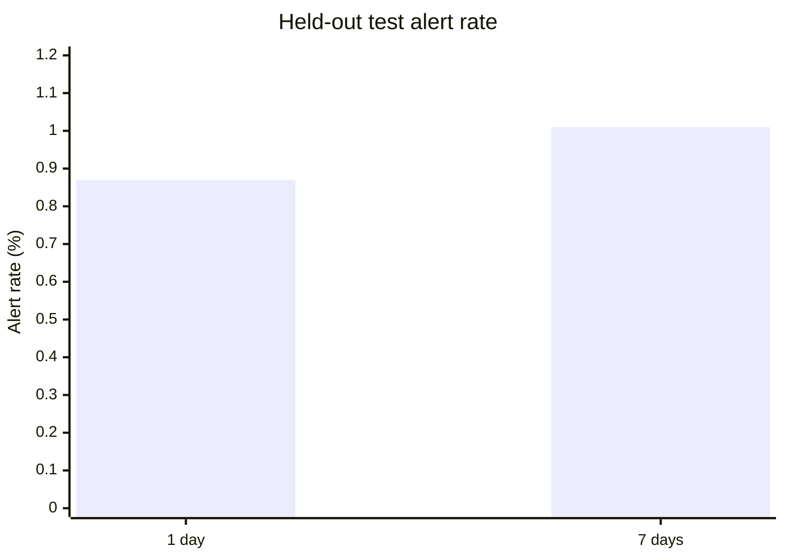
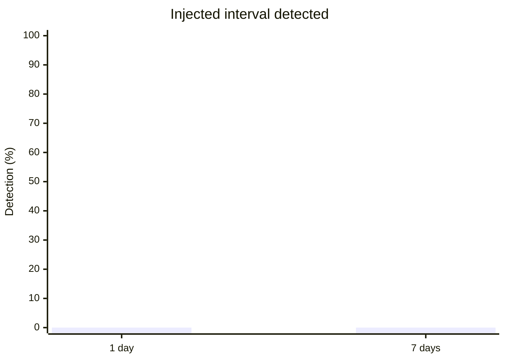

# Marine Time Anomaly Detection Under Distribution Change and Incomplete Observations

## Project Aim

This project explores unsupervised anomaly screening for maritime vessel movement using Automatic Identification System (AIS) data. It combines Isolation Forest and Local Outlier Factor (LOF), and compares one-day and seven-day observation windows. The goal is to study model alerts under different data durations, not to identify intent or establish real-world safety violations.

## Previous Work

1. Ristic, B., La Scala, B., Morelande, M., and Gordon, N. (2008). “Statistical Analysis of Motion Patterns in AIS Data: Anomaly Detection and Motion Prediction.” *11th International Conference on Information Fusion*. This work studies AIS movement patterns for anomaly detection and motion prediction.
2. Pallotta, G., Vespe, M., and Bryan, K. (2013). “Vessel Pattern Knowledge Discovery from AIS Data: A Framework for Anomaly Detection and Route Prediction.” *Expert Systems with Applications*, 40(7), 2325–2334. https://doi.org/10.1016/j.eswa.2012.10.098. This work presents AIS-based vessel pattern analysis for anomaly detection and route prediction.

## Results

| Observation window | Verified AIS dates | Sample rows | Test alerts | Test alert rate |
|---|---:|---:|---:|---:|
| 1 day | 1 | 200,000 | 261 | 0.87% |
| 7 days | 7 | 200,000 | 303 | 1.01% |

### Test Alert Rate

### Controlled Simulation Detection

A controlled speed-change simulation was also run for each window. The detector did not flag the injected interval in either run. Historical AIS has no adjudicated anomaly labels, so alert counts and rates are not accuracy measures; the simulation is limited and does not validate real-world performance.

## Data Source

AIS data came from the NOAA Office for Coastal Management (OCM) Marine Cadastre 2024 daily broadcast GeoParquet product. The experiments used verified daily records from January 1, 2024 (one-day run) and January 1–7, 2024 (seven-day run). Raw data files are not included in this repository; the project downloads source data as needed.

- [NOAA Marine Cadastre AIS data and access instructions](https://github.com/ocm-marinecadastre/ais-vessel-traffic)
- [2024 daily broadcast filename list](https://github.com/ocm-marinecadastre/ais-vessel-traffic/blob/main/data/daily-2024-parquet-filenames.md)
- [Daily broadcast product metadata](https://github.com/ocm-marinecadastre/ais-vessel-traffic/blob/main/data/ais-broadcast-points-2024-readme.md)
